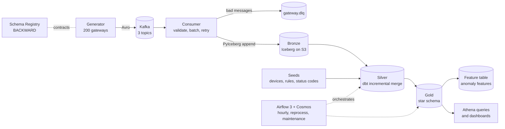
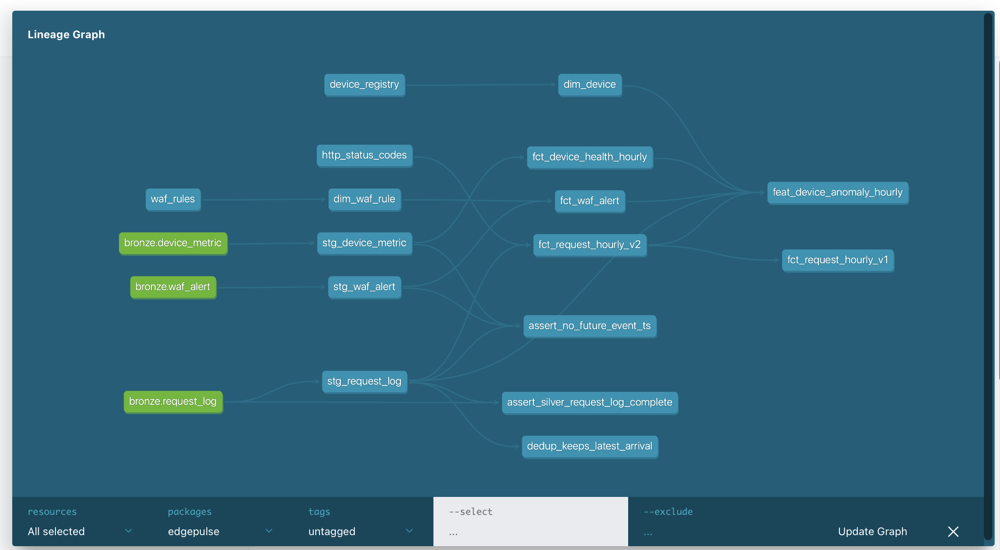
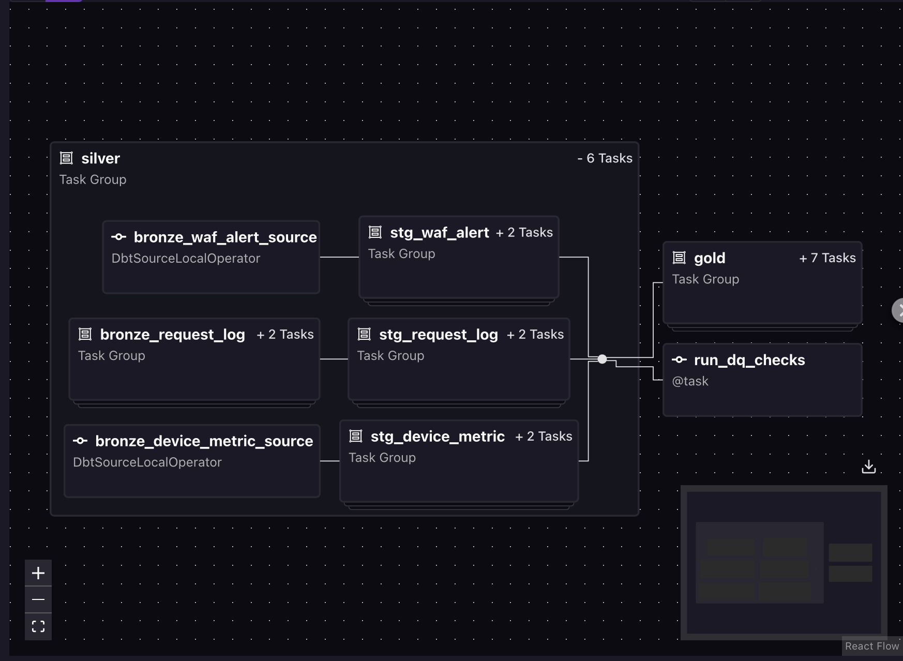

# EdgePulse: product telemetry lakehouse


A streaming data platform that turns raw events from a simulated fleet of 200 app-delivery gateways (request logs, web application firewall alerts and health metrics) into trusted, documented, tested data for dashboards and anomaly detection.

**Stack:** Apache Kafka (KRaft), Confluent Schema Registry with Avro, Apache Iceberg on Amazon S3, AWS Glue Data Catalog, Amazon Athena, dbt Core with dbt-athena, Airflow 3 with Astronomer Cosmos, Python, Docker, pytest, ruff and GitHub Actions.

> A personal portfolio project on synthetic data, with a single-node Kafka on Docker and the lake on an AWS Free plan account.


## What's built

| Area | Highlights |
|---|---|
| Contracts and ingestion | Avro contracts with BACKWARD compatibility, a consumer with validation, a dead-letter topic, retries and at-least-once delivery into Iceberg bronze |
| Schema evolution | request_log v2 added an optional `tls_version` with no downtime: bronze widened itself and silver appended the column |
| Transformation | dbt silver (incremental merge, PII hashing, late-data flags) and a gold star schema with an enforced contract, model versions and an ML feature table |
| Orchestration | Airflow 3 with Cosmos: hourly pipeline with a freshness gate and health checks, weekly Iceberg maintenance and targeted reprocessing of any event-time window |
| Quality | pytest, dbt unit, generic and singular tests, source freshness and hourly health checks written to `ep_ops.dq_results` |
| Operations | Runbooks for six failure modes, two RCAs, a RAID log and a failure drill repaired from bronze and proven with Iceberg time travel |
| CI | GitHub Actions: ruff, pytest, dbt parse and a schema compatibility gate that fails the build on a breaking contract |

## Architecture



**How data flows**
1. The generator produces Avro events to `gateway.request_log`, `gateway.waf_alert` and `gateway.device_metric`, keyed by device_id. Each event type has a versioned contract in Schema Registry with BACKWARD compatibility.
2. The consumer validates each message, routes unreadable or invalid ones to a dead-letter topic with error headers and appends good ones to Iceberg bronze tables in micro-batches. Offsets are committed only after a successful write.
3. dbt builds silver: one row per unique event, merged on event_id, with hashed client IPs, a late-arrival flag and parsed headers and JSON.
4. dbt builds gold: device and rule dimensions, hourly fact tables and an ML feature table.
5. Airflow runs it hourly. Freshness blocks publishing if bronze is stale, tests run after every model and health checks alert beside gold.

## Lineage





## Data model

| Layer | Tables | Grain and purpose |
|---|---|---|
| Bronze (`ep_bronze`) | request_log, waf_alert, device_metric | Raw events as received, partitioned by day, plus Kafka partition, offset and ingest time for lineage and replay. Duplicates allowed |
| Silver (`ep_silver`) | stg_request_log, stg_waf_alert, stg_device_metric | One row per event_id. Incremental Iceberg merge with a 2-hour lookback |
| Reference (`ep_silver`) | device_registry, waf_rules, http_status_codes | dbt seeds maintained in Git |
| Gold (`ep_gold`) | dim_device, dim_waf_rule | Current device and rule attributes |
| Gold | fct_request_hourly (v1, v2) | Device by hour: requests, client and server errors, p50 and p95 latency, a mergeable latency digest. Enforced contract |
| Gold | fct_waf_alert | One row per alert, enriched with the rule catalogue |
| Gold | fct_device_health_hourly | Device by hour: average and peak CPU, memory and connections |
| Gold | feat_device_anomaly_hourly | Dense device by hour spine with rolling 24-hour z-scores, lags, completeness and lateness ratios |
| Ops (`ep_ops`) | dq_results | One row per health check per run |

## Key design decisions

Full reasoning is in [`docs/adr/`](docs/adr/).

- **At-least-once delivery with an idempotent merge**, not exactly-once. The consumer commits offsets after the write, so a crash replays messages. Silver merges on event_id, so replays and duplicates never double count.
- **Late data is handled by arrival time.** Silver reads by `_ingest_ts`, so a late event is always picked up. Gold recomputes every hour that received new events, so hourly totals are corrected.
- **Accurate percentiles at any level.** Percentiles cannot be averaged, so each hourly row stores a quantile digest that can be merged to get p95 by version, tenant or day.
- **Contracts at both ends.** Avro contracts with BACKWARD compatibility on the way in. An enforced dbt contract and model versions on the main gold fact on the way out. v2 split error counts into client and server errors, and v1 remains as a deprecated view.
- **No silent data loss on schema change.** If records carry a field the cached contract lacks, the consumer re-reads the registry and fails the batch if the field is still unknown, so offsets are not committed and nothing is dropped.
- **Bronze is the source of truth for repairs.** A reprocess mode rebuilds any event-time window from bronze through silver and gold. Nobody edits silver or gold by hand.
- **PII never leaves bronze.** Client IPs are replaced in silver by a salted SHA-256 hash. The salt is held outside Git.
- **Point-in-time correct features.** Rolling windows exclude the current hour, a dense spine makes missing data explicit and product version comes from the event rather than the current registry.

## Quality and testing

- **pytest** (20 tests) for the consumer, contracts and bronze writer: validation, retry with exponential backoff, DLQ routing, schema evolution and the stale-contract guard.
- **dbt unit test** proving the dedup rule: two copies of an event collapse to one and the latest arrival wins.
- **dbt generic tests:** unique, not null, accepted values and relationships between facts, dimensions and seeds.
- **dbt singular tests:** no event times in the future, and every bronze event up to the silver watermark exists in silver.
- **Source freshness** on bronze: warn after 15 minutes, error after 60. It blocks silver and gold, so stale data is never published as fresh.
- **Pipeline health checks** (duplicate rate, late rate, hourly volume, dead-row ratio) run hourly beside gold, write to `ep_ops.dq_results` and alert on failure.
- **CI on every push:** ruff, pytest, dbt parse and a schema gate that starts Kafka and Schema Registry, registers every contract version in order and checks that a known breaking contract is rejected.
- DLQ volume and consumer lag are not checked from Airflow, because Kafka runs on a separate Docker network. In production they would come from Amazon MSK or CloudWatch metrics.

## Results

From [`docs/perf.md`](docs/perf.md), measured on the same day before and after maintenance:

| Metric | Before | After |
|---|---|---|
| Athena data scanned, three typical queries | 1,615 KB | 775 KB (**-52%**) |
| Bronze data files | 62 | 1 |
| Dead rows in silver | 54,805 | 0 |
| Duplicates in silver after a 4.9% duplicate injection | | 0 (72,996 rows from 76,746 bronze rows) |

## Reliability drills

- **Consumer crash mid-batch:** killed after the write and before the offset commit. On restart the batch was replayed, silver deduplicated it and no data was lost.
- **Poison messages:** malformed messages land in `gateway.dlq` with the error, source topic, partition and offset in headers. A missing offset found during testing was traced to the DLQ, confirming nothing was silently dropped.
- **Schema v2 rollout:** a breaking version was rejected by the registry. The compatible v2 was registered, then the consumer and producer were rolled out in that order, with no downtime and old rows reading as null.
- **Duplicate surge and bad manual cleanup ([RCA-002](docs/rca/RCA-002-silver-damaged-during-duplicate-incident.md)):** the duplicate check alerted while gold stayed correct. A drill DELETE and UPDATE then damaged one hour of silver (14,702 rows deleted, about 30,200 rows changed or missing). Targeted reprocessing rebuilt the hour from bronze and Iceberg time travel showed 0 differences from the pre-incident snapshot.
- **Breaking contract in a pull request:** CI's schema gate failed the build and nothing reached main.

## Lessons learned

| Issue | Cause | Fix |
|---|---|---|
| Silver and gold held 43% and 55% dead rows | A safety lookback plus MERGE updating every matched row caused write amplification under Iceberg merge-on-read | `update_condition` so rows are rewritten only when a newer copy arrives. Then compaction ([RCA-001](docs/rca/RCA-001-merge-write-amplification.md)) |
| `$files` row counts did not match `count(*)` | Athena's `$files` does not list Iceberg delete files | Measured dead rows as file records minus visible rows, checked per file with `"$path"` |
| dbt ignored the configured S3 location | The Athena workgroup overrode client-side settings | Turned the override off. Query limits are unaffected |
| Iceberg table models failed with "unique table location" | dbt-athena builds a new table beside the old one and swaps by rename | Unique S3 naming for table models only |
| Unit test fixtures failed on map and timestamp types | dbt-athena casts fixture columns with Glue type names and runs unit tests through millisecond-precision Hive tables | SQL-format fixtures and a timestamp-type macro overridden in the test |
| Seeds were created as Hive tables | Seeds do not inherit model configuration | Set the Iceberg table type for seeds explicitly |
| Airflow image build failed on `mmh3` | The Astro image runs Python 3.14 and dbt-athena pins an `mmh3` version with no 3.14 wheel, so it had to compile without a C compiler | Added `build-essential` to `packages.txt` |
| Cosmos tasks failed with `No module named 'airflow.providers.amazon'` | Cosmos's Athena profile mapping reads AWS credentials through the Amazon provider | Added `apache-airflow-providers-amazon` to `requirements.txt` |
| Athena OPTIMIZE failed with "Unexpected FilterNode" | OPTIMIZE only accepts filters it can map straight to partitions, and a computed `current_timestamp - interval` is not one | Used Airflow-templated literal dates (`{{ macros.ds_add(ds, -7) }}`) aligned to the day partitions |
| A new contract field could be dropped silently | Newer Schema Registry clients cache the latest schema, and Arrow ignores fields missing from the target schema | The consumer re-reads the registry on unknown fields and fails the batch if they are still unknown |
| Changed values passed every test | Tests check structure and completeness, and a corrupted value that is still valid passes them | Repairs replay from bronze. Value-level reconciliation proposed in RCA-002 |

## Running it

**Prerequisites:** Docker Desktop (8 GB memory), Python 3.13, the Astro CLI, an AWS account with an S3 bucket, Glue databases `ep_bronze`, `ep_silver`, `ep_gold` and `ep_ops`, an Athena workgroup and a least-privilege IAM user configured as the AWS CLI profile `edgepulse` (policy in [`infra/aws/`](infra/aws/)).

```bash
# 1. Kafka, Schema Registry and Kafka UI (http://localhost:8085)
docker compose up -d

# 2. Register every contract version in order (checks compatibility first)
python contracts/register_schemas.py

# 3. Start the generator and the consumer
docker compose --profile generator --profile pipeline up -d --build

# 4. dbt from your machine
python3.13 -m venv .venv-dbt && source .venv-dbt/bin/activate
pip install -r requirements-dbt.txt
echo "EP_PII_SALT=$(openssl rand -hex 16)" >> .env
set -a && source .env && set +a
cd airflow/include/dbt
dbt build
dbt docs generate && dbt docs serve --port 8001

# 5. Airflow (http://localhost:8080). airflow/.env needs AIRFLOW_CONN_AWS_EDGEPULSE and the same EP_PII_SALT
cd airflow && astro dev start

# 6. Lint and tests (from the repo root, in a separate venv)
pip install -r requirements-dev.txt
ruff check . && pytest -q tests
```

Fault injection for drills: `DUPLICATE_RATE=0.05 LATE_RATE=0.02 docker compose up -d generator`.

## Repository layout

```
.github/workflows/      CI: ruff, pytest, dbt parse, schema compatibility gate
contracts/              Avro schemas (v1, v2) and the registration script
generator/              Event generator (container)
ingestion/              Kafka consumer, Iceberg bronze writer, topic routing (container)
tests/                  pytest suite and a breaking contract fixture
airflow/dags/           Hourly, reprocess and maintenance DAGs
airflow/include/        dbt project, Cosmos config, health checks and alerting
scripts/                Performance baseline script
infra/aws/              Least-privilege IAM policy
docs/adr/               Architecture decision records
docs/runbooks/          Runbooks for six failure modes
docs/rca/               Root cause analyses
docs/raid_log.md        Risks, assumptions, issues and dependencies
docs/perf.md            Performance baseline and maintenance results
docker-compose.yml      Kafka, Schema Registry, Kafka UI, generator, consumer
```

## What would change in production

- Amazon MSK instead of local Kafka, with the consumer on ECS or EKS under an IAM role, scaling on lag.
- MWAA or Astro instead of local Airflow, with alerts routed to chat or paging.
- Separate dev, staging and production accounts, infrastructure in Terraform and CI using OIDC to run `dbt build` on changed models.
- Separate pipeline and read-only roles, and the PII salt in Secrets Manager.
- Lag and DLQ alerting from MSK or CloudWatch metrics, and an automated DLQ replay job.

## Next steps

- Hourly bronze, silver and gold reconciliation and a value-level checksum (from RCA-002).
- SCD Type 2 snapshot for slowly changing device attributes.
- Sorted compaction with Spark for faster point lookups.
- A CI check that fails when a registered contract file is edited.