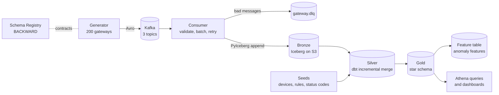

# EdgePulse: product telemetry lakehouse

A streaming data platform that turns raw events from a simulated fleet of 200 app-delivery gateways (request logs, web application firewall alerts and health metrics) into trusted, documented, tested data for dashboards and anomaly detection.

**Stack:** Apache Kafka (KRaft), Confluent Schema Registry with Avro, Apache Iceberg on Amazon S3, AWS Glue Data Catalog, Amazon Athena, dbt Core with dbt-athena, Python, Docker, pytest. Orchestrated with Airflow 3 and Astronomer Cosmos. GitHub Actions CI is in progress.

## Status

| Area | Status |
|---|---|
| Event contracts, generator, Kafka, Schema Registry | Done |
| Consumer to Iceberg bronze with DLQ, retries and at-least-once delivery | Done |
| dbt silver (incremental merge, PII hashing, late-data flags) | Done |
| dbt gold star schema with enforced contract and model versions | Done |
| ML feature table (rolling z-scores, lags, completeness, lateness) | Done |
| Tests: pytest, dbt unit, generic and singular | Done |
| Performance baseline and Iceberg maintenance | Done |
| Airflow 3 orchestration with Cosmos (hourly, one task per dbt model) | Done |
| Pipeline health checks to `ep_ops.dq_results`, freshness gate, failure alerts | Done |
| Failure drill, runbooks and RCA | In progress |
| CI with schema compatibility gate | Planned |

## Architecture



**How data flows**
1. The generator produces Avro events to `gateway.request_log`, `gateway.waf_alert` and `gateway.device_metric`, keyed by device_id. Each event type has a versioned contract in Schema Registry with BACKWARD compatibility.
2. The consumer validates each message, routes unreadable or invalid ones to a dead-letter topic with error headers, and appends good ones to Iceberg bronze tables in micro-batches. Offsets are committed only after a successful write.
3. dbt builds silver: one row per unique event, merged on event_id, with hashed client IPs, parsed headers and JSON, and a late-arrival flag.
4. dbt builds gold: device and rule dimensions, hourly fact tables and an ML feature table.

## Data model

| Layer | Tables | Grain and purpose |
|---|---|---|
| Bronze (`ep_bronze`) | request_log, waf_alert, device_metric | Raw events as received, partitioned by day, plus Kafka partition, offset and ingest time for lineage and replay. Duplicates allowed |
| Silver (`ep_silver`) | stg_request_log, stg_waf_alert, stg_device_metric | One row per event_id. Incremental Iceberg merge with a 2-hour lookback |
| Reference (`ep_silver`) | device_registry, waf_rules, http_status_codes | dbt seeds maintained in Git |
| Gold (`ep_gold`) | dim_device, dim_waf_rule | Current device and rule attributes |
| Gold | fct_request_hourly (v1, v2) | Device by hour: requests, client and server errors, p50 and p95 latency, a mergeable latency digest. Enforced contract |
| Gold | fct_waf_alert | One row per alert, enriched with the rule catalogue |
| Gold | fct_device_health_hourly | Device by hour: average and peak CPU, memory and connections |
| Gold | feat_device_anomaly_hourly | Dense device by hour spine with rolling 24-hour z-scores, lags, completeness and lateness ratios |

## Key design decisions

Full reasoning is in [`docs/adr/`](docs/adr/).

- **At-least-once delivery with an idempotent merge**, not exactly-once. The consumer commits offsets after the write, so a crash replays messages. Silver merges on event_id, so replays and duplicates never double count.
- **Late data is handled by arrival time.** Silver reads by `_ingest_ts`, so a late event is always picked up. Gold recomputes every hour that received new events, so hourly totals are corrected.
- **Accurate percentiles at any level.** Percentiles cannot be averaged, so each hourly row stores a quantile digest that can be merged to get p95 by version, tenant or day.
- **Contracts at both ends.** Avro contracts with BACKWARD compatibility on the way in. An enforced dbt contract and model versions on the main gold fact on the way out. v2 split error counts into client and server errors, and v1 remains as a deprecated view.
- **PII never leaves bronze.** Client IPs are replaced in silver by a salted SHA-256 hash. The salt is held outside Git.
- **Point-in-time correct features.** Rolling windows exclude the current hour, a dense spine makes missing data explicit, and product version comes from the event rather than the current registry.

## Quality and testing

- **pytest** for the consumer: validation, retry with exponential backoff, DLQ routing and the bronze writer.
- **dbt unit test** proving the dedup rule: two copies of an event collapse to one and the latest arrival wins.
- **dbt generic tests:** unique, not null, accepted values and relationships between facts, dimensions and seeds.
- **dbt singular tests:** no event times in the future, and every bronze event up to the silver watermark exists in silver.
- **Source freshness** on bronze: warn after 15 minutes, error after 60.
- `dbt build` skips everything downstream of a failed test, so bad data never reaches gold.
- **Pipeline health checks** (duplicate rate, late rate, hourly volume, dead-row ratio) run hourly beside gold, write to `ep_ops.dq_results` and alert on failure. A bronze **freshness gate** blocks silver if data is over 60 minutes old.
- DLQ volume is not checked from Airflow, because Kafka runs on a separate Docker network. In production it would come from Amazon MSK or CloudWatch metrics.

## Results

From [`docs/perf.md`](docs/perf.md), measured on the same day before and after maintenance:

| Metric | Before | After |
|---|---|---|
| Athena data scanned, three typical queries | 1,615 KB | 775 KB (**-52%**) |
| Bronze data files | 62 | 1 |
| Dead rows in silver | 54,805 | 0 |
| Duplicates in silver after a 4.9% duplicate injection | | 0 (72,996 rows from 76,746 bronze rows) |

## Reliability drills

- **Consumer crash mid-batch:** killed after the write and before the offset commit. On restart the batch was replayed, silver deduplicated it and no data was lost.
- **Poison messages:** malformed messages land in `gateway.dlq` with the error, source topic, partition and offset in headers. A missing offset found during testing was traced to the DLQ, confirming nothing was silently dropped.
- **Duplicate and late event injection:** silver row count matched distinct bronze event_ids, and a second run left counts unchanged.

## Lessons learned

| Issue | Cause | Fix |
|---|---|---|
| Silver and gold held 43% and 55% dead rows | A safety lookback plus MERGE updating every matched row caused write amplification under Iceberg merge-on-read | `update_condition` so rows are rewritten only when a newer copy arrives. Then compaction |
| `$files` row counts did not match `count(*)` | Athena's `$files` does not list Iceberg delete files | Measured dead rows as file records minus visible rows, checked per file with `"$path"` |
| dbt ignored the configured S3 location | The Athena workgroup overrode client-side settings | Turned the override off. Query limits are unaffected |
| Iceberg table models failed with "unique table location" | dbt-athena builds a new table beside the old one and swaps by rename | Unique S3 naming for table models only |
| Unit test fixtures failed on map and timestamp types | dbt-athena casts fixture columns with Glue type names and runs unit tests through millisecond-precision Hive tables | SQL-format fixtures and a timestamp-type macro overridden in the test |
| Seeds were created as Hive tables | Seeds do not inherit model configuration | Set the Iceberg table type for seeds explicitly |
| Airflow image build failed on `mmh3` | The Astro image runs Python 3.14 and dbt-athena pins an `mmh3` version with no 3.14 wheel, so it had to compile without a C compiler | Added `build-essential` to `packages.txt` |
| Cosmos tasks failed with `No module named 'airflow.providers.amazon'` | Cosmos's Athena profile mapping reads AWS credentials through the Amazon provider | Added `apache-airflow-providers-amazon` to `requirements.txt` |

## Running it

**Prerequisites:** Docker Desktop (8 GB memory), Python 3.13, an AWS account with an S3 bucket, Glue databases `ep_bronze`, `ep_silver`, `ep_gold` and `ep_ops`, an Athena workgroup and a least-privilege IAM user configured as the AWS CLI profile `edgepulse`.

```bash
# 1. Kafka, Schema Registry and Kafka UI (http://localhost:8085)
docker compose up -d

# 2. Register the Avro contracts
python contracts/register_schemas.py

# 3. Start the generator and the consumer
docker compose --profile generator --profile pipeline up -d --build

# 4. dbt
python3.13 -m venv .venv-dbt && source .venv-dbt/bin/activate
pip install -r requirements-dbt.txt
echo "EP_PII_SALT=$(openssl rand -hex 16)" >> .env
set -a && source .env && set +a
cd airflow/include/dbt
dbt build
dbt docs generate && dbt docs serve

# 5. Python tests (from the repo root, in a separate venv)
pip install -r requirements-dev.txt
pytest
```

Fault injection for drills: `DUPLICATE_RATE=0.05 LATE_RATE=0.02 docker compose up -d generator`.

## Repository layout

```
contracts/              Avro schemas and the registration script
generator/              Event generator (container)
ingestion/              Kafka consumer, Iceberg bronze writer, topic routing (container)
tests/                  pytest suite
airflow/include/dbt/    dbt project: sources, seeds, silver, gold, macros, tests
scripts/                Performance baseline script
docs/adr/               Architecture decision records
docs/perf.md            Performance baseline and maintenance results
docker-compose.yml      Kafka, Schema Registry, Kafka UI, generator, consumer
```

## Roadmap

- Scheduled Iceberg maintenance (compaction and snapshot expiry) and backfills from the Airflow UI.
- Failure drill: request_log v2 schema rollout, a duplicate incident with targeted backfill and Iceberg time travel, plus runbooks and an RCA.
- GitHub Actions: ruff, pytest, dbt parse and a schema compatibility gate that fails a breaking contract change.
- SCD Type 2 snapshot for slowly changing device attributes. Sorted compaction with Spark for faster point lookups.